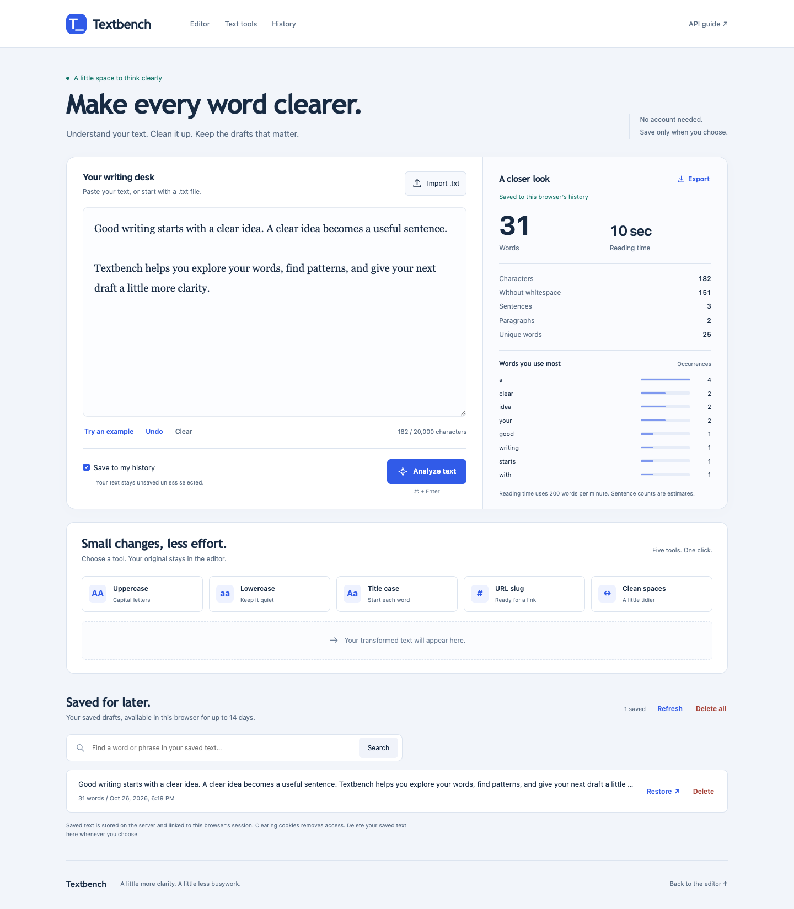

# Textbench

[](https://github.com/bagdaulet-dev/textbench/actions/workflows/ci.yml)

A text-analysis REST API and responsive writing workspace built with **Python,
Django REST Framework, MySQL, Bootstrap, and JavaScript**. Count words, discover
patterns, transform text, and optionally save analyses to private browser-session
history.

The project includes strict request validation, CSRF protection, session-scoped
data access, automated API and browser tests, Docker, and a GitHub Actions pipeline.

[API reference](docs/api.md) · [Architecture](docs/architecture.md) · [Security](docs/security.md) · [Deployment](docs/deployment.md)



See the [mobile screenshot](docs/screenshots/workspace-mobile.png) and
[verification notes](docs/verification.md).

## Features

- Word, character, sentence, paragraph, and unique-word counts.
- Character counts with and without whitespace.
- Estimated reading time and the eight most frequent words.
- Uppercase, lowercase, title case, URL slug, and whitespace cleanup.
- Copy, download, and use transformed text in the editor.
- Import UTF-8 `.txt` files locally and undo replacements or clearing.
- Analyze with Ctrl/Command+Enter and export text/statistics as JSON.
- Read frequency bars and clear inline validation messages on desktop or mobile.
- Optional MySQL-backed history with search, restore, pagination, and confirmed deletion of one or all saved analyses.
- Session isolation: a different browser cannot read or delete your history.
- CSRF protection, input validation, consistent JSON errors, and health checks.
- Responsive frontend served by the same Django application as the API.
- OpenAPI schema and interactive Swagger documentation, enabled locally and disabled by default in production.
- Automated tests, Docker Compose, and GitHub Actions for checks and publishing.
- An optional server deployment job with HTTPS through Caddy.

## Run with Docker — recommended

Install Docker Desktop on macOS/Windows, or Docker Engine with the Compose plugin
on Linux. Start Docker before continuing. You do **not** need to install MySQL
separately: Compose downloads and runs the official MySQL container.

From this repository's root directory:

```bash
cp .env.example .env
docker compose up --build -d --wait
```

The sample credentials in `.env.example` are for local development only.

Open:

- **Application:** <http://localhost:8000/>
- **API documentation:** <http://localhost:8000/api/docs/>
- **Health check:** <http://localhost:8000/api/health/>
- **OpenAPI schema:** <http://localhost:8000/api/schema/>

The first build can take a few minutes. Startup waits for MySQL and applies Django
migrations before starting Gunicorn. Bootstrap is included in the repository;
the main interface needs no external CDN.

On a Mac where Docker was just installed, a terminal that was already open may
not find `docker` yet. For the current terminal session, run:

```bash
export PATH="/Applications/Docker.app/Contents/Resources/bin:$PATH"
```

```bash
docker compose logs -f app       # Follow application logs; Ctrl+C exits the log view
docker compose stop             # Stop containers without deleting data
docker compose start            # Start them again
docker compose down             # Remove containers; keep the database volume
```

MySQL data lives in a named Docker volume. Avoid `docker compose down -v` unless
you intend to delete the local database.

## Local development — edit and see changes

Use **Python 3.12**. Start only MySQL with Docker and run Django locally so changes
to Python, templates, CSS, and JavaScript appear without rebuilding an image.

```bash
cp .env.example .env            # Only if .env does not already exist
python3.12 -m venv .venv
source .venv/bin/activate
pip install -r backend/requirements-dev.txt
docker compose up -d db --wait
python backend/manage.py migrate
python backend/manage.py runserver 127.0.0.1:8000
```

On Windows, activate with `.venv\Scripts\activate`. You may need to use `python`
instead of `python3.12`, depending on your installation.

In VS Code, open **Terminal → Run Task** for the included start, logs, and stop
tasks. The Mac start task also finds Docker immediately after installation.

If the full Compose application is already using port 8000, stop its app service
first with `docker compose stop app`. If port 3306 is already occupied by another
MySQL server, either use that server with matching `.env` credentials or change
the published database port in `compose.yml` and set `MYSQL_PORT` accordingly.

For MySQL installed directly on your computer, create a database using `utf8mb4`
and a dedicated user, set the `MYSQL_*` values in `.env`, and skip starting the
database container. Never use the root database account for the running app.

## Try the application

1. Open the workspace and choose **Try an example**, or enter your own text.
2. Choose **Analyze text** to see the results.
3. Select **Save to my history** before analyzing if you want a saved copy.
4. Choose a transformation such as **URL slug**.
5. Copy the result, download it, or move it into the editor.
6. Restore a saved analysis from History, or delete it.
7. Open a private browser window to see that its history is separate.

Text is sent to this application's server when you analyze or transform it.
Without the save option, the application does not write the submitted text to
the database. Saved text is stored in plain form, so do not save confidential
information to a public demo.

## Project structure

```text
.
├── backend/
│   ├── config/                 # Django settings, URL routing, WSGI
│   ├── text_tools/
│   │   ├── services.py         # Pure text-processing functions
│   │   ├── serializers.py      # Input validation and response definitions
│   │   ├── models.py           # MySQL-backed TextAnalysis model
│   │   ├── views.py            # API endpoints, frontend, and health check
│   │   ├── authentication.py   # CSRF checks for anonymous sessions
│   │   ├── migrations/         # Versioned database structure
│   │   └── management/         # Cleanup command for expired history
│   ├── tests/                  # Function, API, database, and isolation tests
│   ├── requirements*.txt       # Pinned runtime and development dependencies
│   ├── Dockerfile
│   └── manage.py
├── frontend/
│   ├── templates/index.html    # Complete workspace page
│   └── static/                 # JavaScript, CSS, icon, vendored Bootstrap
├── docs/                       # Architecture, API, deployment, design notes
├── scripts/                    # Container startup and server deployment
├── .github/workflows/ci.yml    # Test → build → publish → optional deploy
├── compose.yml                # Local app and MySQL
├── compose.production.yml     # Published app, MySQL, HTTPS proxy
├── Caddyfile
└── .env.example
```

## How one request works

```text
Browser JavaScript
    → POST /api/text/analyze/ with JSON and a CSRF token
    → Django validates the request
    → services.py calculates text statistics
    → optional TextAnalysis record is saved through Django ORM to MySQL
    → JSON response updates the frontend
```

The frontend never connects directly to MySQL. Database credentials stay on the
server. Oracle's MySQL Connector/Python provides the Django database adapter.
Django's built-in migrations track schema changes.

See [architecture](docs/architecture.md) for the database diagram and decisions.

## API

| Method | Endpoint | Purpose |
|---|---|---|
| GET | `/api/csrf/` | Set the CSRF cookie and return a token |
| POST | `/api/text/analyze/` | Analyze text and optionally save it |
| POST | `/api/text/transform/` | Transform text without saving it |
| GET | `/api/text/history/?page=1&search=word` | Search the current browser's history |
| DELETE | `/api/text/history/` | Delete all history belonging to this browser |
| GET | `/api/text/history/{id}/` | Retrieve one saved analysis |
| DELETE | `/api/text/history/{id}/` | Delete one saved analysis |
| GET | `/api/health/` | Check application/database availability |

All POST and DELETE requests require a CSRF cookie and matching `X-CSRFToken`
header. This includes requests from API clients. See [API examples](docs/api.md)
for a complete copyable Python example and response formats.

## Tests and checks

Activate the virtual environment and run:

```bash
ruff check .
ruff format --check .
node --check frontend/static/app.js
pip-audit -r backend/requirements-dev.txt --no-deps --disable-pip
python backend/manage.py check
python backend/manage.py makemigrations --check --dry-run
pytest --cov --cov-report=term-missing
python backend/manage.py spectacular --file /tmp/textbench-schema.yml --validate --fail-on-warn
```

The default test command uses **MySQL**, including JSON and Unicode persistence.
The database user must be allowed to create and drop a database named
`test_textbench`. Grant this permission only to a development/testing account,
not to the production application's account. GitHub Actions uses a disposable
MySQL service with its own CI-only credentials.

For the default local database/user names, grant test-database permissions once:

```bash
docker compose exec db mysql -u root -p
```

Enter the local `MYSQL_ROOT_PASSWORD`, then run this SQL in the MySQL prompt:

```sql
GRANT ALL PRIVILEGES ON test_textbench.* TO 'textbench'@'%';
EXIT;
```

If you changed the database or user names in `.env`, adjust that statement.

If MySQL is temporarily unavailable, the explicit fallback below runs the same
suite using in-memory SQLite. It is useful for quick feedback, but it does **not**
replace a MySQL integration run:

```bash
pytest --ds=config.test_settings --cov --cov-report=term-missing
```

Tests cover transformations, punctuation and Unicode rules, length limits, saved
history, pagination, session isolation, CSRF enforcement, database failures, and
expired-history cleanup. Coverage must remain at least 90% for the application
package.

## Frontend development tools and browser checks

The frontend runs as ordinary HTML/CSS/JavaScript. Node tools are only needed for
formatting and browser verification; they add no browser runtime framework.
Use Node 20 or newer:

```bash
npm ci --ignore-scripts
npm run format:check
npx playwright install chromium
npm run test:browser
```

If Google Chrome is already installed, you can skip downloading Chromium and run
`BROWSER_CHANNEL=chrome npm run test:browser` on macOS/Linux. The browser check
uses its own temporary browser session and synthetic test text. It checks import,
undo, Unicode limits, all five transformations, download/export, history search,
confirmed deletion, and desktop/mobile layout. Screenshots are saved in
`docs/screenshots/`. Dependency installation scripts are disabled in `.npmrc`.

## CI and deployment

Every pull request runs style checks, tests against real MySQL, OpenAPI checks,
and Docker build/start checks. A push to `main` runs the same checks and then
publishes an image to GitHub Container Registry tagged with the commit SHA.

The deployment job is disabled until repository variable `DEPLOY_ENABLED` is
`true` and server credentials are configured. No deployment can happen merely
by cloning this repository. See [deployment instructions](docs/deployment.md)
for the server, DNS, secrets, HTTPS, backups, and rollback steps.

## Text rules and limits

- Maximum input: **20,000 Unicode code points** per request.
- Words include Unicode letters/numbers, with internal apostrophes and hyphens.
- Frequencies ignore case and normalize curly apostrophes. Common words are kept.
- Sentences are nonempty word-containing pieces separated by `.`, `!`, or `?`.
  Abbreviations and decimals can therefore split sentences; this is an estimate.
- Paragraphs are nonempty blocks separated by blank lines.
- Reading time is rounded up at **200 words per minute**.
- Title case uses Python's `str.title()`; it is not an editorial style guide.
- URL slugs use Django's default ASCII conversion. Some scripts produce an empty
  slug, which the frontend explains.
- Clean spaces collapses all whitespace, including line breaks, into single spaces.

## History and maintenance

History belongs to a database-backed browser session and is inaccessible after
that session expires (14 days) or its cookie is removed. There is no login or
cross-device account. Deleting a record removes it immediately. To remove stored
records whose sessions have expired or disappeared, run:

```bash
python backend/manage.py purge_expired_analyses
python backend/manage.py clearsessions
```

Schedule these daily on a deployed server; deployment also runs cleanup once.
Expiry makes history inaccessible immediately, but physical removal depends on
running cleanup. The in-process request limit is a small-demo convenience, not a
distributed abuse-prevention system.

## Security and implementation notes

See [security notes](docs/security.md) for the scope of browser-session protection,
request limits, CSP, production documentation visibility, credentials, and audits.

The browser import reads a UTF-8 `.txt` file of at most 65,536 bytes and 20,000
characters locally. Text goes to the server only after an analysis/transformation
action. Undo keeps only one previous draft in page memory and is cleared on reload.
JSON exports include the current source text; save exported files appropriately.

Keep accounts, background workers, and AI features for later projects.

Bootstrap is distributed under its MIT license. See
[third-party notices](docs/third-party.md). The rest of the project is currently
provided without an added open-source license; the repository owner can choose one.
