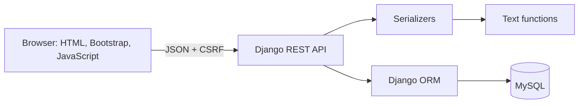
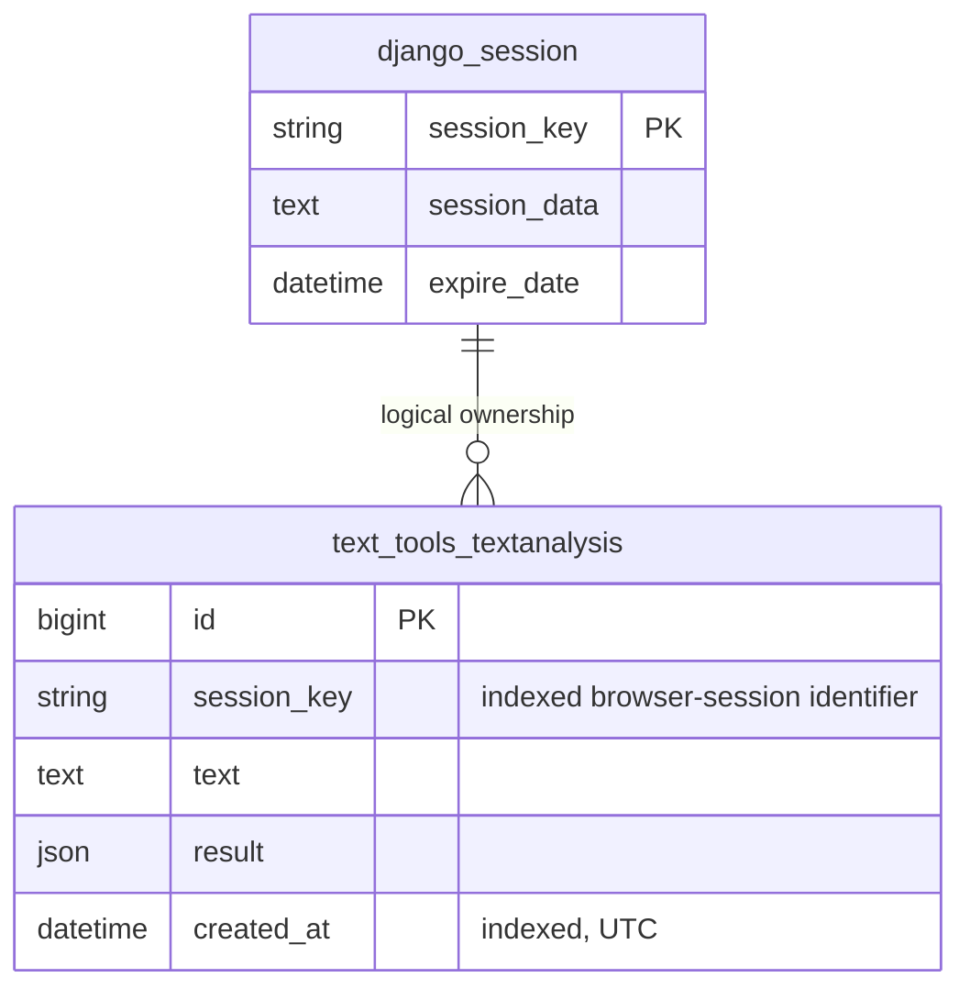

# Architecture and implementation guide

## Components

Textbench is one Django application. Django renders a single HTML page and serves
a JSON REST API. Plain JavaScript calls that API with `fetch`. WhiteNoise serves
the bundled CSS, JavaScript, Bootstrap, and favicon in the Docker image. Gunicorn
is the application server. MySQL stores sessions and saved analyses.

## Responsibilities

| File | Responsibility |
|---|---|
| `services.py` | Counts and transformations; independent of HTTP and storage |
| `serializers.py` | Validates input and describes the API output |
| `models.py` | Defines saved analysis fields and ordering |
| `views.py` | Coordinates validation, functions, persistence, and responses |
| `authentication.py` | Applies CSRF checks even before a session exists |
| `exceptions.py` | Converts database failures into safe 503 responses |
| `schema.py` | Documents the CSRF header in OpenAPI |
| `frontend/static/app.js` | Handles browser interaction and API requests |

A separate repository layer would duplicate Django ORM for this small project.
No background queue, cache server, or frontend build step is required. Development-only Node tools provide source formatting and browser tests.

## Database

The ownership link is logical rather than a database foreign key. Django controls
the session table and its cleanup lifecycle; the cleanup command explicitly
removes analysis records with no active session. The session identifier is never
returned in analysis JSON. An index makes session-scoped history lookups efficient.

`result` is a JSON snapshot, so restoring history reproduces the saved analysis
without recalculation. This trades some duplicated data for a simpler model.
If counting rules change later, add a result version or recalculate old records.

## Sessions and request protection

There are no user accounts. The first saved analysis creates a Django session
and sets an HttpOnly session cookie. History queries always filter using that
session's key. An unknown or foreign ID returns 404 for both retrieval and delete.
This reduces accidental data exposure without building an authentication system.

An anonymous session still needs CSRF protection. Django REST Framework's default
session authenticator enforces CSRF for authenticated users; this project's
subclass enforces it on every unsafe request. The page sets a CSRF cookie and
JavaScript sends it back in `X-CSRFToken`.

Treat a session cookie like a password: someone with a copy can access that
session's data. Cookies use SameSite=Lax and are secure in production. Use HTTPS.
Do not log submitted request bodies. Text is inserted into the frontend through
`textContent` and textarea values, never interpreted as HTML.

## Error behavior

- Invalid or missing input: 400 with field-specific errors.
- CSRF failure: 403.
- Missing/foreign history item: 404.
- Unsupported method: 405.
- Unsupported content type: 415; API writes accept JSON.
- Request throttle: 429, with an in-process per-IP counter.
- Database unavailable: 503 with a generic message.

The frontend handles empty, loading, success, and failure states. A failed history
request leaves a retry action; it does not show invented records. Editing input
clears old analysis so statistics do not describe outdated text.

## Development boundaries

MySQL is the normal database everywhere, including CI. A named, explicit test
settings module offers in-memory SQLite only for machines without MySQL. Results
from that fallback must be reported as fallback tests, not MySQL verification.

The local Compose file exposes MySQL and the app only on the loopback interface.
Production exposes Caddy on ports 80/443 and keeps the app and MySQL private on
the Compose network. Trust in `X-Forwarded-Proto` is enabled only in that production
topology. The health endpoint is exempt from HTTPS redirection for internal
container health checks.

## Improved request and privacy boundaries

`parsers.py` bounds JSON input before deserialization. Native framework size
exceptions are translated into the same 413 JSON response. A strict text field
rejects non-string values and malformed Unicode before the text functions run.
`middleware.py` sets CSP, capability restrictions, and no-store responses for the
workspace and API, including error responses. `documentation.py` gates both docs
and schema using a setting evaluated on each request.

History search applies after the session ownership filter. Collection deletion
uses the ownership filter directly and intentionally clears every owned row,
including records hidden by search or pagination. The UI confirms this action
and serializes it against in-flight saves.

The app receives an environment allowlist with its restricted MySQL account.
Only MySQL receives the administrative database password. One Gunicorn worker
keeps the demo limiter in one process; a shared store is needed before scaling.
The configured trusted production proxy contributes exactly one forwarded hop.
Gunicorn access logs omit query strings and request bodies.
